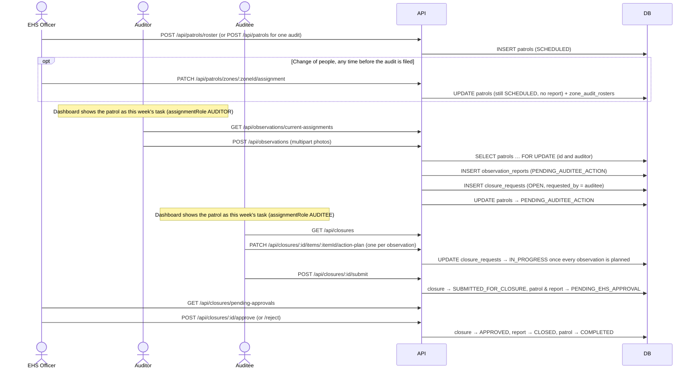
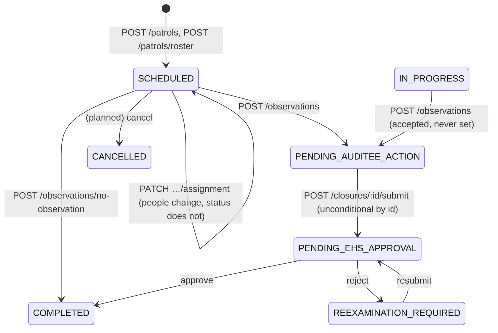
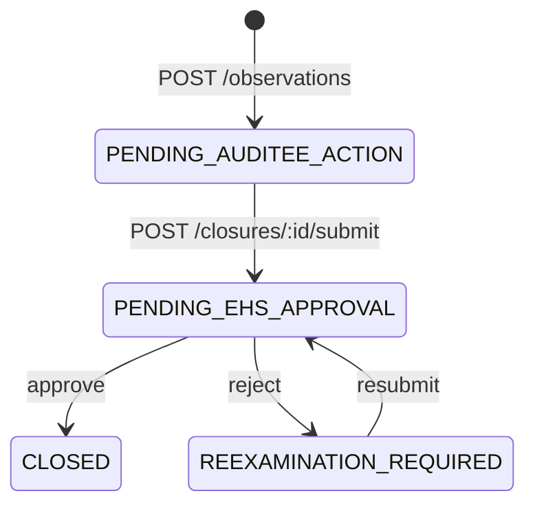

# 5. Workflows and status machines

## End-to-end happy path

The three actors need not be three people. The EHS Officer may also be the auditor or the auditee of a patrol they planned (never both), and may approve a closure on which they are the auditee ([below](#the-ehs-officer-as-a-participant)).

## Status machines (what the code actually does)

Legend: solid = implemented transition with its endpoint; dashed = value exists in the DB CHECK constraint but no code path sets it.

### `patrols.status`

Never written today: `IN_PROGRESS`, `CANCELLED`. Queries nevertheless filter on `CANCELLED` (dashboard, reassignment, roster generation). Reassignment leaves the status alone and only ever touches a patrol that is still `SCHEDULED` with no observation report; see [Reassigning auditors and auditees](#reassigning-auditors-and-auditees).

### `observation_reports.status`

`OPEN` is only the column default and is never inserted by the multi-observation path. **"No observation to record"** (`POST /api/observations/no-observation`) inserts `CLOSED` directly with `no_observations = true`, opens **no** closure, and moves the patrol straight to `COMPLETED` — the one path where an audit finishes without an auditee ever acting.

**The auditor's own view of a report is binary** and derived, not stored: `OPEN` while no report exists, `CLOSED` once one does (either sent to the auditee or closed with no observations). The stored column above still drives the auditee/officer loop. The API also returns `lifecycleStatus`/`lifecycleLabel` summarising the whole journey: `NO_OBSERVATIONS`, `CLOSED_VIA_CLOSURE` (the officer approved the closure — the terminal state for a report that had findings), `EHS_OFFICER_ACTION_REQUIRED`, `REEXAMINATION_REQUIRED`, `ACTION_PLAN_IN_PROGRESS`, else `WITH_AUDITEE`.

**Deadline.** A report is due by **Thursday of the audit's ISO week** (`dueDate` = Monday + 3 days). Past that it is flagged `isOverdue` and kept in the auditor's pending list for 4 more weeks, but submission is never blocked.

### `closure_requests.status`

Derived, not set by hand ([19](19-remove-tickets-plan.md)): `OPEN` while any observation lacks an action plan, `IN_PROGRESS` once every observation has one, then the review loop. The auditee sends the whole closure for approval; the EHS Officer's approval is what makes it `APPROVED` ("Closed") and completes the patrol. A rejection advances `approval_iteration` and reopens every observation for rework.

**Evidence does not gate any of this.** Up to three photographs may be attached to each observation as proof the plan was carried out, and none is required — it is the officer's approval that decides whether what was attached was enough.

The action-ticket layer that used to sit between the auditee and the officer, and the `ACTION_HOD` role that worked it, were removed in migration 018.

```mermaid
stateDiagram-v2
    [*] --> OPEN : POST /observations (auto-created)
    OPEN --> IN_PROGRESS : PATCH item action-plan (every observation planned)
    IN_PROGRESS --> IN_PROGRESS : PATCH item action-plan
    REEXAMINATION_REQUIRED --> IN_PROGRESS : PATCH item action-plan
    IN_PROGRESS --> SUBMITTED_FOR_CLOSURE : POST submit (every observation planned)
    SUBMITTED_FOR_CLOSURE --> APPROVED : approve
    SUBMITTED_FOR_CLOSURE --> REEXAMINATION_REQUIRED : reject with comments
    SUBMITTED_FOR_CLOSURE --> REJECTED : (never written; candidate to drop)
```

Never written: `REJECTED`. Approve and reject write the review columns migration 006 added (`reviewed_by`, `reviewed_at`, `review_comments`, `approval_iteration`, `approved_at`).

## Reassigning auditors and auditees

Decided in [20](20-dashboard-assignment-editing-plan.md) D3–D5 and D7, amending [14](14-weekly-roster-plan.md) D8. The roster is uploaded once and the people on a zone change during the year, so changing them is routine and is done from the EHS Officer's dashboard week card, not by re-uploading.

**What can move.** An audit is *reassignable* while it is `SCHEDULED` **and** has no observation report. Anything else is *under way*: its report and closure already name the people doing it, so it keeps them. Cancelled audits are ignored.

**Zone edit** (`PATCH /api/patrols/zones/:zoneId/assignment`, the dashboard's "Every audit of this zone"):

1. Range: from `max(fromDate, Monday of the current UTC week)` to 31 December of that date's year. The dashboard sends the week card's `zoneEditFromDate`, which is the Monday of the week being viewed.
2. Every reassignable audit of the zone in the range takes the new pair, hand-planned and roster-generated alike. Under-way audits in the range are counted as skipped and named in the confirmation.
3. The zone's roster row takes the new pair if its effective range overlaps the reassigned one, so the roster page and the next report show it.
4. Nothing reassignable → `409 NO_REASSIGNABLE_AUDITS`, nothing changed.

The current-week clamp is deliberate. On a Wednesday, Monday's audit that nobody has filed yet can still be handed over; an overdue audit from an earlier week stays with the auditor who owes it. And because the edit needs no anchor audit, a report filed on Monday never blocks changing the zone's future.

**One-off swap** (`PATCH /api/patrols/:patrolId/assignment` with `applyToUpcoming: false`, the dashboard's "Only this audit"): changes one audit while it is still `SCHEDULED`, and nothing else. The roster row keeps the zone's usual pair. The card offers it only for an audit with no report (`canEditAssignment`); the endpoint itself checks the status alone, which a filed report always changes.

**`applyToUpcoming: true`** (the API default, never sent by the dashboard) runs the zone edit from that patrol's own date, unclamped, and fails as a whole with `409 PATROL_NOT_EDITABLE` if that patrol is itself under way.

**Which weeks offer an edit** (D7). Past weeks are read-only: their audits are history, or still owed by whoever was rostered. In the current and later weeks a zone row offers **Edit** when either the one-off swap is possible (`canEditAssignment`) or the zone has reassignable audits from that week to 31 December (`canEditZone`). The card's `reassignableCount` uses the same rule as the endpoint, so the number it offers is the number that changes.

**Concurrency** (D12). Filing a report, or closing an audit with no observation, locks the patrol row before reading it, matched on id and auditor; the reassignment locks the zone's audits in the range before updating them. One side waits: either the reassignment then skips the filed audit, or the old auditor gets `404 ASSIGNED_PATROL_NOT_FOUND` and files nothing. The report, closure and patrol always name the same pair.

**A roster re-upload overwrites these edits.** It deletes and regenerates every upcoming roster-generated audit that is still `SCHEDULED` with no report, from the file. Hand-planned audits keep their people. The Plan page's re-upload confirmation says so.

## The EHS Officer as a participant

Decided in [20](20-dashboard-assignment-editing-plan.md) D8–D10.

- **Anyone active at the plant may be an auditor or an auditee, the officer included.** The officer appears in the planning form's choices and the dashboard edit's selects (marked "(you)"), and may put their own email in the roster file. The only person rule is that one audit's auditor and auditee differ (`patrol_auditor_auditee_check`, `zone_audit_rosters_people_differ`); nothing ties `patrols.ehs_officer_id` to either.
- **They then do the work like anyone else**: file the observation report as auditor, or answer the closure as auditee. Observation and closure routes check patrol membership, not role.
- **They may approve a closure on which they are the auditee.** A business decision; segregation of duties was considered and declined. The approval panel shows "You are the auditee of this audit, so approving it signs off your own action plans." and the queue marks the row "(you)". Approval routing is unchanged, so such a closure is in the officer's own queue.
- **Their dashboard prompts them.** Management users get their own `nextAudit`, shown above the week card only when they have a task this week, and the calendar marks their own patrols "Auditor"/"Auditee" instead of "Assigned".

## The weekly inspection report

`GET /api/patrols/weekly-report` ([21](21-weekly-inspection-pdf-plan.md)) lists every audit scheduled at the officer's plant in one Monday-to-Sunday week. **Inspected** means an observation report was filed, the same test the dashboard metrics and the spreadsheet report use, so "no observation to record" counts as inspected. **Not done** is red. A zone with more than one audit that week counts as inspected in the summary only when every one of them has a report, and as **with observations** when any report has findings. An audit whose Thursday deadline has not yet passed still reads "Not done", with "Due by Thu …" under it.

## Who sees what, and when

| Step | Query that surfaces it | Condition |
|---|---|---|
| Auditor's task this week | `GET /dashboard` → `nextAudit` (every role, management included); `GET /observations/current-assignments` | patrol in current ISO week, `auditor_id = me`, no report yet |
| Auditee's task this week | `GET /dashboard` → `nextAudit` (every role) | patrol in current week, `auditee_id = me`, report status OPEN/PENDING_AUDITEE_ACTION/REEXAMINATION_REQUIRED, and the closure **not yet submitted or approved** ([20](20-dashboard-assignment-editing-plan.md) D11; it used to test for any closure row, which the report creates at once, so the prompt never fired) |
| Auditee's open closures | `GET /closures` | `requested_by = me`, status OPEN/IN_PROGRESS/REEXAMINATION_REQUIRED/SUBMITTED_FOR_CLOSURE, sent-back first; plus those approved in the last few days |
| EHS review queue | `GET /closures/pending-approvals` (`MANAGEMENT_ROLES`) | status SUBMITTED_FOR_CLOSURE on patrols whose `ehs_officer_id` is me or null, oldest submission first; includes closures on which I am the auditee |
| EHS Officer's week card | `GET /dashboard` → `officerWeek` (default week); `GET /dashboard/officer-week?weekStart=` (any week, `PLANNING_ROLES`) | the officer's plant, one Monday-to-Sunday week, non-cancelled patrols |
| HOD / Plant Head / Admin week view | `GET /dashboard` → `nextWeek` | all non-cancelled patrols in the current week |

## Invariants the code relies on

- One observation report per patrol (unique `patrol_id`); one closure per report (unique `observation_report_id`).
- Closure rows are created by the **observation** module, not the closure module. `requested_by` means "assigned to (auditee)".
- Auditor ≠ auditee (DB CHECK) is the only person rule. Eligibility for planning is by location: any active user at the officer's plant, the officer included. Observation and closure access is by patrol membership, not role.
- A patrol's people change only while it is `SCHEDULED` (filing a report moves it out of that status in the same transaction; the zone edit also checks for a report), and filing locks the patrol row first, so a report and its closure always name the patrol's current pair.
- "Today" is server-local in patrols/closures and UTC in the dashboard. Keep containers on one timezone (UTC) and treat this as a refinement item.
- The week window of `nextAudit` and `nextWeek` is always the real current week regardless of the `year`/`month` requested. Only the officer's week card moves between weeks, through its own endpoint.
